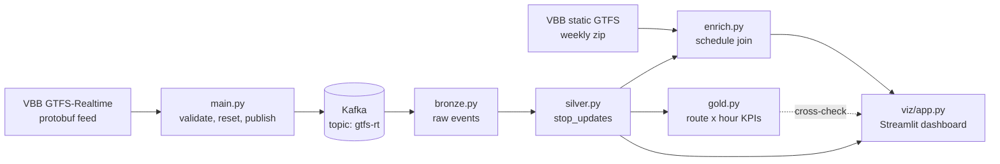

# VBB Realtime Data Pipeline


Real-time public-transport analytics for Berlin and Brandenburg: ingest the VBB GTFS-Realtime feed, publish it to Kafka, model it with Spark, and explore delay patterns in a six-tab Streamlit dashboard.

This is a local, reproducible data-engineering portfolio project. It focuses on the parts that are easy to get wrong with real feeds: schema drift, missing values, sentinel values, schedule matching, and keeping streaming and batch outputs consistent.

## At a glance

| Area | Implementation |
|---|---|
| Domain | Public transport / mobility analytics |
| Input | VBB GTFS-Realtime protobuf + static GTFS schedule |
| Ingestion | Python 3.13, `requests`, `gtfs-realtime-bindings`, `confluent-kafka` |
| Streaming | Apache Kafka 4.3, Spark Structured Streaming 4.2 |
| Storage | Parquet with explicit schemas |
| Analytics | Spark SQL, pandas, PyArrow |
| Presentation | Streamlit, Altair, PyDeck |
| Local stack | Docker Compose + `uv` |
| Status | Working local prototype, not a production deployment |

## What this project demonstrates

- **End-to-end ownership** from a public API and protobuf payload to a usable analytics product.
- **Streaming and batch modelling** with bronze, silver, and gold layers and a clear separation between realtime and static data.
- **Data contracts** through explicit Spark schemas rather than inferred JSON/CSV types.
- **Data-quality engineering** around missing delays, VBB's `32767` “no delay info” sentinel, skipped stops, and static-schedule matches.
- **Developer experience** with a one-command container stack, a documented run order, and a dashboard that explains its own caveats.

## Architecture



The dashboard is built from the **silver** stop-update table. Gold is a compact route/hour summary used for cross-checking, not a dependency for the main views.

### Pipeline stages

| Stage | File | Responsibility |
|---|---|---|
| 1. Ingest | `main.py` | Fetch one GTFS-RT snapshot, validate the protobuf, reset the previous collection session, write `.pb`/`.json`, publish entities to Kafka |
| 2. Bronze | `spark/bronze.py` | Read Kafka with an explicit envelope schema, add ingestion timestamps, append raw Parquet |
| 3. Silver | `spark/silver.py` | Parse JSON, explode trip stop updates, enforce types, write one row per trip/stop update |
| 4. Enrich | `spark/enrich.py` | Join to `stop_times.txt`, reconstruct scheduled epochs, measure schedule deviation and match quality |
| 5. Gold | `spark/gold.py` | Aggregate reported delays per route and ingestion hour: coverage, mean, P50, P90, max, skipped count |
| 6. Dashboard | `viz/app.py` | Six-tab Streamlit app for delay distributions, line/stop rankings, data quality, and trip inspection |

## Dashboard

The app runs at `http://localhost:8501` and includes:

| Tab | What it answers |
|---|---|
| **Overview** | How much of the feed reports delays? What are the mean, median, P90, and P95? |
| **Distribution** | Is the delay distribution zero-inflated? How do arrival and departure delays compare? What does the ECDF look like? |
| **Lines** | Which lines are most delayed by mean, P90, or coverage? Where along a route does delay accumulate? |
| **Stops & Zones** | Which stops and fare zones have the worst P90? Where are they on the map? |
| **Data quality** | How many updates match the static schedule? Do arrival and departure delays agree? How many sentinel values were removed? |
| **Trip explorer** | For one trip, what happened stop by stop, including skipped stops and Berlin-local predicted departures? |

The UI deliberately shows **coverage alongside delay metrics**. Around half of the stop updates in a typical VBB snapshot carry no usable departure delay, so treating missing values as zero would make the system look better than the data actually is.

## Stack

| Layer | Tools |
|---|---|
| Language | Python 3.13 |
| Ingestion | `requests`, `gtfs-realtime-bindings`, `protobuf`, `confluent-kafka`, `python-dotenv` |
| Streaming | Apache Kafka 4.3.1, Spark Structured Streaming 4.2.0 |
| Storage | Parquet, PyArrow |
| Analytics | Spark SQL, pandas |
| Dashboard | Streamlit, Altair, PyDeck, CARTO basemap tiles |
| Tooling | `uv`, Ruff, Docker Compose, PowerShell |

## Quickstart

### Prerequisites

- Docker Desktop with Compose v2. The Spark worker is configured with 10 GB; adjust `docker-compose.yml` if your Docker VM has less memory.
- [`uv`](https://docs.astral.sh/uv/) for Python 3.13 and dependency management.
- PowerShell for the commands below (the full sequence is in [`RUN_ORDER.md`](RUN_ORDER.md)).
- Internet access for the VBB feed and the dashboard's CARTO basemap.

### 1. Install dependencies

```powershell
uv sync
```

### 2. Configure the feed user agent

Create `.env` in the repo root:

```dotenv
VBB_USER_AGENT=your-name/your-project (contact details)
```

VBB rate-limits the realtime endpoint to 60 requests per minute and expects an identifying user agent.

### 3. Download the static schedule

Download the current VBB GTFS zip from the [VBB dataset page](https://unternehmen.vbb.de/en/digital-services/datasets), place it at `data/gtfs.zip`, and extract it:

```powershell
Expand-Archive data\gtfs.zip -DestinationPath data\gtfs -Force
```

`enrich.py` needs `data/gtfs/stop_times.txt`. Refresh the static feed weekly; a stale zip lowers the schedule-match rate.

### 4. Start the local stack

```powershell
docker compose up -d
```

This starts Kafka, Kafka UI, the Spark master/worker, and the Streamlit container. The dashboard's first start may take a couple of minutes while Streamlit and its dependencies are installed; it will show an empty state until the pipeline has produced data.

### 5. Collect one snapshot and publish it

```powershell
uv run python main.py
```

`main.py` validates the protobuf **before** it truncates the Kafka topic or deletes derived outputs. It then writes `data/gtfs-rt.pb` and `data/gtfs-rt.json` and publishes the entities to `gtfs-rt`.

> Each run starts a new collection session. Do not run it while a bronze or silver streaming job is active; it clears the previous checkpoints and the bronze/silver outputs.

### 6. Build the medallion layers

The full copy-paste sequence is in [`RUN_ORDER.md`](RUN_ORDER.md). In short:

```powershell
docker exec -e HOME=/tmp spark /opt/spark/bin/spark-submit --conf spark.jars.ivy=/tmp/.ivy2 --packages org.apache.spark:spark-sql-kafka-0-10_2.13:4.2.0 /opt/spark/work-dir/spark/bronze.py
docker exec -e HOME=/tmp spark /opt/spark/bin/spark-submit --conf spark.jars.ivy=/tmp/.ivy2 --packages org.apache.spark:spark-sql-kafka-0-10_2.13:4.2.0 /opt/spark/work-dir/spark/silver.py
docker exec -e HOME=/tmp spark /opt/spark/bin/spark-submit /opt/spark/work-dir/spark/enrich.py
docker exec -e HOME=/tmp spark /opt/spark/bin/spark-submit /opt/spark/work-dir/spark/gold.py
```

Bronze and silver use `trigger(availableNow=True)` and exit when they have drained the available data. Enrichment and gold are batch jobs and also exit on their own.

### 7. Open the dashboard

The dashboard is part of the Compose stack:

- Dashboard: [http://localhost:8501](http://localhost:8501)
- Kafka UI: [http://localhost:8080](http://localhost:8080)
- Spark UI: [http://localhost:8081](http://localhost:8081)

### 8. Check and stop

```powershell
uv run ruff check .
docker compose ps
docker compose down
```

## Data model

| Output | Grain | Key fields |
|---|---|---|
| `data/bronze/gtfs-rt` | One row per Kafka message | `key`, `value`, `topic`, `partition`, `offset`, `timestamp`, `ingested_at` |
| `data/silver/stop_updates` | One row per trip/stop update | `tripId`, `routeId`, `stopId`, `stopSequence`, arrival/departure delay and epoch, `scheduleRelationship`, `ingested_at` |
| `data/gold/delay_validation` | One row per enriched stop update | scheduled epochs, arrival/departure deviation, `delta_to_reported`, `schedule_matched`, `stop_match` |
| `data/gold/delay_validation_summary` | One row per route | matched-update count, mean/max absolute schedule deviation |
| `data/gold/otp_by_route_hour` | One row per route and ingestion hour | `n_total`, `n_trips`, `n_skipped`, `n_reported`, `avg_delay`, `p50_delay`, `p90_delay`, `max_delay` |

`n_total` counts stop updates, not trips. `gold.hour` is the **ingestion** hour, not the service hour. A true time-of-day profile needs repeated collection runs and is intentionally left for the next iteration.

## Engineering decisions

**Validate before destroying state.** `main.py` parses the protobuf before it resets Kafka and the derived layers. A 200 response with an HTML error page therefore fails without deleting the last good session.

**Missing is not zero.** About half of the stop updates carry no delay. VBB also uses `32767`, the GTFS-RT int16 maximum, as “no delay information”. Averages and percentiles run only over reported values, and the dashboard always shows coverage beside them.

**A skipped stop is not an on-time stop.** Delay statistics are restricted to `scheduleRelationship == "SCHEDULED"`; skipped stops are counted separately.

**Explicit schemas everywhere.** Kafka envelopes, GTFS-RT JSON, silver columns, and static `stop_times.txt` all have declared types. This makes failures visible instead of silently producing nulls or strings.

**Batch and streaming have different jobs.** Bronze and silver are streaming queries with checkpoints and `availableNow`; enrichment and gold are idempotent batch jobs with `mode("overwrite")`. Gold is a summary, not a streaming sink, because the Parquet DataSource sink does not support `outputMode("complete")`.

**Static and realtime time are reconciled carefully.** GTFS `HH:MM:SS` values can exceed 24 hours. The enrichment job converts them to epoch seconds in the `Europe/Berlin` timezone, then compares them with the realtime epoch timestamps.

## Project structure

```text
.
├── main.py                  # fetch, validate, reset, publish one snapshot
├── spark/
│   ├── bronze.py            # Kafka -> raw Parquet
│   ├── silver.py            # JSON -> stop_updates
│   ├── enrich.py            # static schedule join + validation
│   └── gold.py              # route/hour delay summary
├── viz/
│   └── app.py               # Streamlit dashboard
├── spark_job.py             # debug console sink
├── docker-compose.yml       # Kafka, Kafka UI, Spark master/worker, viz
├── RUN_ORDER.md             # canonical copy-paste run sequence
├── ATTRIBUTION.md           # data sources and attribution
└── data/                    # generated/ignored: GTFS, bronze, silver, gold
```

## Scope and next steps

This is a working local prototype, not a production service. Current boundaries:

- One snapshot per run; no continuous collector or scheduler yet.
- Gold is keyed by ingestion hour, so it cannot answer “how does delay vary by time of day” until the feed is collected repeatedly.
- The static GTFS feed is refreshed manually.
- Kafka and Spark run as a single local broker/master; there is no high-availability or cloud deployment.
- Ruff is the current automated check; there is no test suite or CI pipeline yet.

Natural next steps:

- Add a scheduler and retain multiple collection sessions for time-series analysis.
- Add pytest coverage for schemas, sentinel handling, and schedule matching.
- Add CI for linting and tests.
- Move the storage layer to Delta Lake or Iceberg for ACID updates and time travel.
- Add route geometry and a proper map layer; expose the gold tables through a small API.
- Deploy the stack to a cloud environment with managed Kafka and object storage.

## For reviewers

The most relevant files for a data-engineering review are:

1. `main.py` — ingestion contract and failure behaviour.
2. `spark/silver.py` — schema enforcement and the raw-to-normalized transformation.
3. `spark/enrich.py` — static/realtime join, timezone handling, and data-quality metrics.
4. `spark/gold.py` — delay semantics, sentinel handling, and aggregation design.
5. `viz/app.py` — turning the model into an explorable product with explicit data caveats.

## Data attribution

Realtime data © Verkehrsverbund Berlin-Brandenburg (VBB), licensed under CC-BY 4.0, via [production.gtfsrt.vbb.de](https://production.gtfsrt.vbb.de/data). Static GTFS schedule © VBB, via the [VBB dataset page](https://unternehmen.vbb.de/en/digital-services/datasets).

This project is a portfolio demo and is not affiliated with VBB. See [`ATTRIBUTION.md`](ATTRIBUTION.md) for details.
